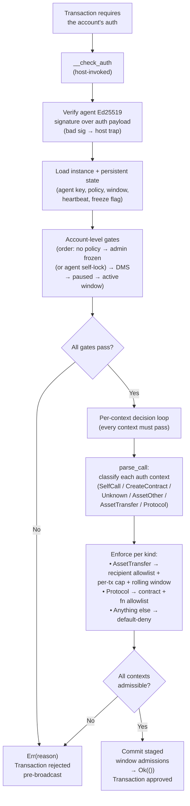

# Architecture

The `__check_auth` → `parse_call` → `decide` pipeline is the core of Stellar Agent Guard. Every transaction the guarded account makes flows through this pipeline.

## Pipeline diagram

## Walkthrough

### 1. Signature verification

`__check_auth` loads the registered agent pubkey and calls `env.crypto().ed25519_verify` over the transaction auth payload. This runs before any policy logic, so a compromised-but-unregistered key never reaches the decision table.

### 2. Policy snapshot

The current `PolicyConfig`, `AdminFrozen`, `LastHeartbeat`, and ledger time are loaded. No policy stored ⇒ `NoPolicy` — the account is default-deny.

### 3. Account-level gates

Evaluated in this order (first match wins):

| # | Condition | Result |
|---|---|---|
| 1 | No `Policy` stored | Block (`NoPolicy`) |
| 2 | `AdminFrozen` is set (admin `freeze` or agent `self_lock`) | Block (`AdminFrozen`) |
| 3 | DMS enabled AND `last_heartbeat != 0` AND `now - last_heartbeat > dms_grace_secs` | Block (`HeartbeatExpired`) |
| 4 | `paused` | Block (`Paused`) |
| 5 | Outside `active_from`/`active_until` | Block (`OutsideActiveWindow`) |

These gates apply **equally to every call** — SAC transfers, protocol calls, and even `heartbeat`.

### 4. Per-context classification

Each `Context` in `auth_contexts` is classified independently by `parse_call`:

| ParsedCall | Classification |
|---|---|
| `SelfCall { heartbeat, self_lock }` | Allowed (only permitted self-calls) |
| `SelfCall { other }` | Blocked (`SelfFunctionNotAllowed`) |
| `CreateContract` | Blocked (`CreateContractNotAllowed`) |
| `AssetTransfer` | Fully enforceable (recipient + amount parsed from args) |
| `AssetOther` (e.g., `mint`, `burn`) | Blocked (`FunctionNotAllowed`) |
| `Protocol` | Contract + function allowlist check |
| `Unknown` | Blocked (`UnknownContract`) — default-deny |

### 5. Per-kind enforcement

**Asset transfers** (SAC `transfer`/`transfer_from` on allowlisted assets):
1. Recipient allowlist check (unless `allow_any_recipient`)
2. Per-tx cap check
3. Rolling window projection (existing total + amounts staged earlier in this request)
4. Amount > 0 check

**Protocol calls** (allowlisted non-asset contracts):
1. Contract in `protocols` list
2. Function in rule's `fns` allowlist (if configured)

**Everything else:** Blocked.

### 6. All-or-nothing commit

Window admissions are **staged** — they are only committed to storage if *every* context passes. A partially-validating batch can never spend. `Ok(())` approves; `Err(reason)` rejects the entire transaction, and the `auth_checked` event records the outcome either way.

## Decision table

The full decision table from SPEC §4, evaluated against ledger time (which Soroban code cannot forge):

| Priority | Condition | Action | Error |
|---|---|---|---|
| 1 | No policy | Block | `NoPolicy` |
| 2 | `AdminFrozen` (admin `freeze` or agent `self_lock`) | Block | `AdminFrozen` |
| 3 | DMS grace elapsed | Block | `HeartbeatExpired` |
| 4 | `paused` | Block | `Paused` |
| 5 | Outside active window | Block | `OutsideActiveWindow` |
| 6 | Self-call to `heartbeat` / `self_lock` | Allow | — |
| 7 | Per-context classification (§6) | Allow or Block | Various |

## Storage model

| Key | Type | Kind | Purpose |
|---|---|---|---|
| `Initialized` | `bool` | instance | One-time flag for `initialize` |
| `Admin` | `Address` | instance | Policy admin; set at `initialize`, rotated via §7.2 handover |
| `PendingAdmin` | `Address` | instance | Proposed admin awaiting confirmation (absent = none pending) |
| `AgentPubkey` | `BytesN<32>` | instance | Agent's Ed25519 public key |
| `Policy` | `PolicyConfig` | persistent | Current policy (`None` = default-deny) |
| `Window` | `WindowState` | persistent | Rolling spend ledger |
| `LastHeartbeat` | `u64` | persistent | Unix seconds of last heartbeat (0 = never) |
| `AdminFrozen` | `bool` | persistent | Admin-initiated freeze flag |

Instance keys auto-refresh TTL on every invocation; persistent keys are extended to the maximum TTL on every write.

## Enforcement-Equivalent Upgrade Policy

Contracts on Soroban are immutable once deployed. When operators ask whether to redeploy for new contract versions (v2+), the decision follows our **enforcement-equivalent upgrade** policy:

- **Security Fixes:** Mandatory redeploy advisory. Operators must upgrade as soon as practical to maintain platform security guarantees.
- **Additive Features:** Optional redeploy. Existing policies and state continue functioning without modification.
- **Guarantee Changes:** Explicit migration checklist required:
  1. Export existing policy (`policy()`).
  2. Deploy new contract artifact.
  3. Initialize new contract and set policy (`initialize`, `set_policy`).
  4. Rotate keys if needed.
  5. Verify operational status (`status()`).

**Note on State Migration:** There is no automatic on-chain migration primitive; state is moved by admin re-entry (export/reimport). Window history resets upon migration (fresh window on new contract instance).

## Code layout

| File | Purpose |
|---|---|
| `src/lib.rs` | Contract: lifecycle, admin, `__check_auth` (CustomAccount), events, storage helpers |
| `src/engine.rs` | Pure decision table over auth `Context`s — no storage access, fully unit-testable |
| `src/window.rs` | Genuinely rolling spend window (lazy prune, same-second coalescing, bounded backstop) |
| `src/types.rs` | Policy model, storage keys, errors, parsed-call enum |
| `src/integration_tests.rs` | Host-routed tests with real Ed25519 auth signatures |

## Threat model boundary (SPEC §2)

This diagram shows what the guard enforces, what the underlying Stellar account layer enforces, and what remains explicitly outside the scope of this contract (v1). It follows the enforcement boundary stated in [SPEC §2](../SPEC.md#2-enforcement-scope--sac-token-calls-vs-every-other-soroban-call-required-framing).

```mermaid
flowchart LR
    subgraph OUTSIDE ["Outside scope (v1)"]
        direction TB
        O1["Per-call amount limits\nfor non-SAC calls"]
        O2["Recipient limits\nfor non-SAC calls"]
        O3["Rolling-window accounting\nfor non-SAC calls"]
        O4["Off-chain fraud detection\nor compliance monitoring"]
        O5["Key custody\n(the Ed25519 secret is\nheld by the agent)"]
        O6["Multi-sig / threshold\nsigning (v2 item)"]
    end

    subgraph ACCOUNT ["Stellar account layer\n(enforced by the host, not this contract)"]
        direction TB
        A1["Sequence number /\nreplay protection"]
        A2["Signature validity\n(Ed25519 over auth payload,\nverified by host before\ncalling __check_auth)"]
        A3["Ledger sequence /\ntimestamp integrity\n(cannot be forged in-contract)"]
    end

    subgraph GUARD ["Stellar Agent Guard\n(this contract — enforced inside __check_auth)"]
        direction TB
        G1["Admin freeze /\nself-lock"]
        G2["Dead-man switch\n(heartbeat + grace window)"]
        G3["Pause flag"]
        G4["Active window\n(active_from / active_until)"]
        G5["Default-deny\ncontract classification"]
        G6["Protocol / function\nallowlist"]
        subgraph SAC_ONLY ["SAC transfers only\n(transfer / transfer_from)"]
            S1["Recipient allowlist"]
            S2["Per-tx amount cap"]
            S3["Per-asset cap"]
            S4["Rolling window\nspend accounting"]
        end
    end

    ACCOUNT --> GUARD
    GUARD -. "out of scope" .-> OUTSIDE
```

### What the guard enforces

The guard's enforcement is applied inside `__check_auth`, which the Soroban host invokes on every transaction that requires the guarded account's authorization. All rules apply to **every** call the account makes:

- **Admin freeze / self-lock** — the account is blocked entirely until an admin unfreezes it.
- **Dead-man switch** — if the agent misses a heartbeat for longer than `dms_grace_secs`, the account auto-freezes.
- **Pause flag** — the operator can pause all activity without changing the policy.
- **Active window** — activity is blocked outside the `active_from`/`active_until` range.
- **Default-deny contract classification** — only contracts in `assets` or `protocols` can be called; everything else is blocked with `UnknownContract`.
- **Protocol / function allowlist** — only contracts listed in `protocols` are reachable, with optional per-contract function restrictions.

For **SAC token transfers** (`transfer`/`transfer_from` on `assets`-listed contracts), additional rules apply:
- Recipient allowlist or `allow_any_recipient` escape.
- Per-tx amount cap (global and per-asset).
- Rolling-window spend accounting.

### What the underlying account layer enforces

The Stellar protocol and Soroban host enforce independently:
- Signature validity — the host verifies the agent's Ed25519 signature over the transaction auth payload before calling `__check_auth`. A bad signature never reaches policy logic.
- Replay protection — the standard Soroban auth replay window prevents the same signed payload from being reused.
- Ledger timestamp and sequence number integrity — smart contract code cannot forge `env.ledger().timestamp()` or `env.ledger().sequence()`.

### What is out of scope

The following are explicitly **not** enforced by this contract in v1:

- **Per-call amount or recipient limits for non-SAC calls** — the Soroban auth context does not expose call arguments generically for arbitrary contracts. This is a platform boundary, not a gap to close in this contract; see [Enforcement Scope](enforcement-scope.md) for the full statement.
- **Off-chain fraud detection** — the contract has no network access or oracle; it enforces only the rules an operator has pre-configured in the policy.
- **Key custody** — the agent's Ed25519 secret is held by the agent software, outside the contract. A leaked key means a compromised agent, not a failed guard (the guard still enforces policy even then, but cannot revoke the key; use `initialize` admin rotation for key compromise recovery).
- **Multi-sig / threshold signing** — v1 registers a single Ed25519 key; multi-sig is tracked as a v2 item in [ADR-0003](adr/0003-ed25519-single-key-over-multisig-v1.md).

> See [SPEC §2](../SPEC.md#2-enforcement-scope--sac-token-calls-vs-every-other-soroban-call-required-framing) for the canonical, normative statement of the enforcement boundary.
